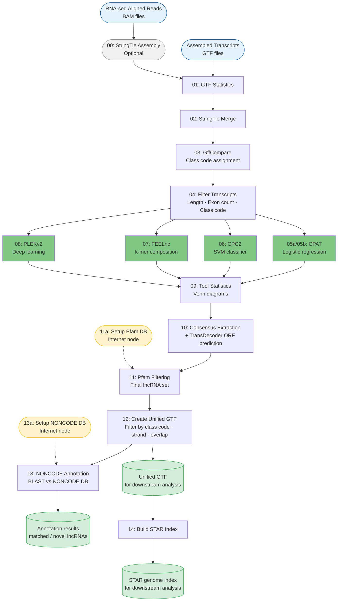

# DD-lncRNA: SLURM Pipeline for lncRNA Detection

A comprehensive SLURM-based pipeline for detecting and quantifying novel long non-coding RNAs (lncRNAs) from RNA-seq data.

## Overview

This pipeline is a SLURM-compatible and identifies novel lncRNAs from assembled transcripts through a multi-step filtering and validation process:

0. **StringTie assembly** - Assemble transcripts from BAM files (Optional - if you don't have GTF files)
1. **GTF statistics** - Generate statistics for individual StringTie assemblies
2. **Assembly merging** - Combines multiple sample assemblies (StringTie)
3. **Transcript classification** - Identifies candidate lncRNAs by class code (gffcompare)
4. **Basic filtering** - Length, exon count, and class code criteria
5. **Coding potential assessment** - Four independent tools (CPAT, FEELnc, PLEKv2, CPC2)
   - **Option A**: Build custom models from reference data (CPAT, FEELnc)
   - **Option B**: Use pre-built models (CPAT, FEELnc, PLEKv2)
6. **Tool statistics** - Comprehensive analysis and visualization of tool agreement
7. **Consensus extraction** - Extract candidates with simplified consensus strategy (0-3 scale)
8. **ORF prediction** - TransDecoder ORF analysis on consensus candidates
9. **Pfam filtering** - Filter transcripts with protein domains to create final lncRNA set (with detailed stats)
10. **Unified GTF creation** - Filter and combine reference and novel lncRNAs into a single validated GTF file (run before annotation)
11. **NONCODE annotation** - Annotate the filtered lncRNA set against NONCODE to identify matched vs novel lncRNAs
12. **STAR index** - Build STAR genome index with the augmented annotation for downstream alignment (optional)

## Pipeline Diagram




## Features

- ✅ **Modular SLURM scripts** - Easy to customize and run individual steps
- ✅ **Four coding potential tools** - CPAT, FEELnc, PLEKv2, CPC2 with configurable thresholds
- ✅ **Flexible consensus strategy** - All tools agree (intersection), 3/4 tools (majority), 2/4 tools, or any tool (union)
- ✅ **Five class codes** - u (intergenic), x (antisense), i (intronic), o (overlap), j (multi-exon junction)
- ✅ **Comprehensive statistics** - At every step, overall and per-class-code
- ✅ **Venn diagrams** - Visual comparison of tool agreement
- ✅ **Optional quantification** - Complete workflow with STAR, Kallisto, Salmon
- ✅ **Conda environment** - All dependencies managed via conda

## Directory Structure

```
DD-lncRNA/
├── environment_explicit.txt  # Conda environment specification
├── environment_explicit_feelnc.txt  # Conda environment specification for Feelnc tool
├── README.md                 # This file
└── scripts/
    ├── 00_stringtie_assemble.sh    # StringTie assembly from BAM files
    ├── 01_gtf_stats.sh       # GTF statistics for individual samples
    ├── 02_stringtie_merge.sh # Merge StringTie assemblies
    ├── 03_gffcompare.sh      # Compare with reference annotation
    ├── 04_filter_transcripts.sh # Filter candidate transcripts
    ├── 05a_cpat.sh           # CPAT with custom model building
    ├── 05b_cpat.sh           # CPAT with pre-built models
    ├── 06_cpc2.sh            # CPC2 coding potential
    ├── 07_feelnc.sh          # FEELnc with model training
    ├── 08_plek.sh            # PLEKv2 coding potential
    ├── 09_tool_stats.sh      # Comprehensive tool statistics & visualizations
    ├── 10_coding_consensus.sh # Extract candidates & TransDecoder ORF prediction
    ├── 11a_setup_pfam.sh     # Setup Pfam database (run on internet node)
    ├── 11_orf_pfam.sh        # Pfam domain filtering & final lncRNA generation (with stats)
    ├── 12_create_unified_gtf.sh # Create unified GTF combining reference and novel lncRNAs
    ├── 13a_setup_blast.sh    # Setup NONCODE database (run on internet node)
    ├── 13_annotation.sh      # NONCODE homology annotation
    ├── 14_create_STAR_db.sh  # Build STAR genome index for downstream alignment
    └── calculate_cpat_threshold.R # R script for CPAT threshold calculation
```

## Quick Start

### 1. Create Conda Environment
- lncrna environment: containing most of the tools
```bash
# Create the main conda environment from environment_explicit.txt
conda create --name lncrna --file environment_explicit.txt

# Activate the environment when needed
conda activate lncrna
```

- FEELnc: environment to run FEELnc tool
```bash
# Create the FEELnc conda environment from environment_explicit_feelnc.txt
conda create --name FEELnc --file environment_explicit_feelnc.txt

# Activate the environment when needed
conda activate FEELnc
```

- PLEK2: environment to run PLEK2 tool
```bash
# Create separate PLEK2 environment following https://github.com/AHinsu/plek2
# Option 1: Automated setup
git clone https://github.com/AHinsu/plek2.git
cd plek2
./setup.sh

# Option 2: Manual setup
conda create -n PLEK2 -y -c conda-forge \
    python=3.8.5 \
    numpy=1.19.2 \
    pandas \
    biopython \
    keras=2.4.3 \
    tensorflow=2.4.1 \
    regex

conda activate PLEK2

# Clone repository and download models
git clone https://github.com/AHinsu/plek2.git
cd plek2/utils
wget -O PLEK2_model_v3.tar.gz https://sourceforge.net/projects/plek2/files/PLEKv2_allfiles_240807.tar.gz
tar -xzf PLEK2_model_v3.tar.gz
bunzip2 PLEK2_model_v3/*.bz2
mv PLEK2_model_v3/*.h5 .
rm -rf PLEK2_model_v3 PLEK2_model_v3.tar.gz
cd ..

# Copy scripts and models within PLEK2 conda environment. Replace $CONDA_PREFIX with path to PLEK2 conda environment, usually ~/.conda/envs/PLEK2
cp bin/*.py "$CONDA_PREFIX/bin/"
mkdir -p "$CONDA_PREFIX/utils"
cp utils/*.h5 "$CONDA_PREFIX/utils/"
```

### 2. Configure Each Script

Each script contains a "USER CONFIGURATION" section at the top where you need to set your paths and parameters. Edit the following variables in each script before running:

**Example variables to edit in each script:**
```bash
# Output directory (same across all scripts)
OUTDIR="./results"

# Conda environment name
CONDA_ENV="lncrna"

# Reference files (used by multiple scripts)
REFERENCE_GTF="/path/to/reference/genes.gtf"
REFERENCE_FASTA="/path/to/reference/genome.fa"
INPUT_GTF_DIR="/path/to/gtf/files"
INPUT_BAM_DIR="/path/to/bam/files"  # For quantification only

# Coding potential thresholds (adjust for your species)
CPAT_THRESHOLD=0.364  # Human default
```

### 3. Create SLURM Log Directory

```bash
# Create the sbatch_logs directory
mkdir -p /storage/users/${USER}/sbatch_logs
```

### 4. Run the Pipeline

Run scripts sequentially, waiting for each job to complete before submitting the next:

```bash
cd scripts

# Submit jobs one at a time, waiting for completion
sbatch 01_gtf_stats.sh
# Wait for job to complete (check with: squeue -u $USER)

sbatch 02_stringtie_merge.sh
# Wait for job to complete

sbatch 03_gffcompare.sh
# ... continue through all steps
```

**Pipeline Steps (run in order):**
```bash
# Optional: If you don't have GTF files yet
sbatch 00_stringtie_assemble.sh  # Assemble transcripts from BAM files

# Main pipeline
sbatch 01_gtf_stats.sh          # GTF statistics
sbatch 02_stringtie_merge.sh    # Merge assemblies
sbatch 03_gffcompare.sh         # Compare with reference
sbatch 04_filter_transcripts.sh # Filter transcripts

# CPAT - Choose ONE of the following:
sbatch 05a_cpat.sh              # CPAT with custom model building (for any organism)
# OR
sbatch 05b_cpat.sh              # CPAT with pre-built models (Human, Mouse, Fly, Zebrafish)
sbatch 06_cpc2.sh               # CPC2 coding potential
sbatch 07_feelnc.sh             # FEELnc with model training
sbatch 08_plek.sh               # PLEKv2 coding potential
sbatch 09_tool_stats.sh         # Comprehensive tool statistics (run before consensus)

# Extract lncRNA candidates and predict ORFs
sbatch 10_coding_consensus.sh   # Extract candidates & TransDecoder ORF prediction

# Setup databases (run on nodes with internet access)
sbatch 11a_setup_pfam.sh        # Setup Pfam database for script 11
sbatch 13a_setup_blast.sh       # Setup NONCODE database for script 13

# Filtering and annotation
sbatch 11_orf_pfam.sh           # Pfam filtering & final lncRNA generation

# Create unified GTF combining reference and novel lncRNAs (FIRST - before annotation)
sbatch 12_create_unified_gtf.sh # Filtering by class codes, strand, and overlap; unified GTF creation

# NONCODE annotation of the filtered lncRNA set (AFTER script 12)
sbatch 13_annotation.sh         # NONCODE homology annotation of filtered candidates

# Build STAR genome index (optional, for downstream alignment)
sbatch 14_create_STAR_db.sh     # Build STAR genome index using merged_filter.gtf
```

## Pipeline Steps

### Step 00: StringTie Assembly (Optional)

**When to use:** Run this step if you are starting with BAM files (aligned RNA-seq reads) and don't have GTF files yet.

Assembles transcripts from aligned BAM files using StringTie. This step uses SLURM array jobs to process multiple samples in parallel.

**Inputs:**
- `INPUT_BAM_DIR`: Directory containing BAM files (aligned RNA-seq reads)
- `REFERENCE_GTF`: Reference genome annotation GTF file

**Outputs:**
- `${OUTDIR}/stringtie_assembly/*.lncRNA.gtf` - One GTF file per BAM file
- `${OUTDIR}/stringtie_assembly/*.log` - Assembly logs

**Configuration:**
- Adjust `--array` parameter to match the number of BAM files (e.g., `--array=0-134%10` for 135 files)
- Set `MIN_LENGTH` for minimum transcript length (default: 200 nt)
- Set `STRAND_SPECIFIC` for strand-specific data (--rf, --fr, or empty)

**Skip this step if:** You already have StringTie GTF files from previous analysis.

### Step 01: GTF Statistics

Generates statistics for individual StringTie GTF files including transcript counts, gene counts, and exon distributions.

**Inputs:**
- `INPUT_GTF_DIR`: Directory containing StringTie GTF files
- `GTF_PATTERN`: Pattern to match GTF files (default: `*.gtf`)

**Outputs:**
- `${OUTDIR}/gtf_stats/individual/*.stats.txt` - Detailed statistics for each GTF file
- `${OUTDIR}/gtf_stats/individual/*.summary.json` - JSON summary for each GTF file

**Configuration:**
- Adjust `--array` parameter to match the number of GTF files
- Set `GTF_PATTERN` to match specific GTF naming conventions (e.g., `*.lncRNA.gtf` for script 00 output)

### Step 02: StringTie Merge

Merges multiple StringTie GTF assemblies into a unified transcriptome using StringTie's merge function.

**Inputs:**
- `INPUT_GTF_DIR`: Directory containing StringTie GTF files to merge
- `REFERENCE_GTF`: Reference genome annotation GTF file

**Outputs:**
- `${OUTDIR}/stringtie_merge/merged.gtf` - Unified transcriptome GTF
- `${OUTDIR}/stringtie_merge/merged_stats.txt` - Statistics for merged GTF
- `${OUTDIR}/stringtie_merge/merge_list.txt` - List of GTF files that were merged

**What it does:**
Combines multiple sample assemblies while retaining transcripts that appear in multiple samples and using the reference annotation as a guide.

### Step 03: GffCompare

Compares merged transcripts with reference annotation using gffcompare to identify novel transcripts and assign class codes.

**Inputs:**
- `${OUTDIR}/stringtie_merge/merged.gtf` - Merged transcriptome from step 02
- `REFERENCE_GTF` - Reference genome annotation GTF file

**Outputs:**
- `${OUTDIR}/gffcompare/gffcmp.annotated.gtf` - Merged GTF with class code annotations
- `${OUTDIR}/gffcompare/gffcmp.tracking` - Tracking file showing transcript relationships
- `${OUTDIR}/gffcompare/gffcmp.loci` - Locus structure information
- `${OUTDIR}/gffcompare/gffcmp.stats` - Comparison statistics
- `${OUTDIR}/gffcompare/class_code_stats.txt` - Summary of class code distributions

**What it does:**
Assigns class codes to each transcript indicating its relationship to the reference annotation (u=intergenic, x=antisense, i=intronic, o=overlap, j=multi-exon junction, etc.).

### Step 04: Filter Transcripts

Filters transcripts based on class code, length, and exon count criteria to identify lncRNA candidates.

**Inputs:**
- `${OUTDIR}/gffcompare/gffcmp.annotated.gtf` - Annotated GTF from step 03
- `REFERENCE_FASTA` - Reference genome FASTA file (for sequence extraction)

**Outputs:**
- `${OUTDIR}/filtered_transcripts/filtered.gtf` - Filtered transcripts GTF
- `${OUTDIR}/filtered_transcripts/filtered.fasta` - Filtered transcript sequences
- `${OUTDIR}/filtered_transcripts/class_code_info.tsv` - Metadata table with class codes
- `${OUTDIR}/filtered_transcripts/filter_stats.txt` - Filtering statistics
- `${OUTDIR}/filtered_transcripts/filter_summary.json` - Filtering summary (JSON)

**Configuration:**
- `MIN_LENGTH`: Minimum transcript length (default: 200 nt)
- `MIN_EXONS`: Minimum exon count rule(s) (default: `1`)
  - Set one value (example: `MIN_EXONS="2"`) to apply the same minimum exon count to all class codes
  - Set one value per class code in the same order as `CLASS_CODES` (example: `CLASS_CODES="u,x,i,o,j"` with `MIN_EXONS="2,1,1,1,2"`)
  - `MIN_EXONS` must have either 1 value or exactly the same number of values as `CLASS_CODES`
- `CLASS_CODES`: Target class codes to keep (default: u,x,i,o,j)

In `scripts/04_filter_transcripts.sh`, set these values in the user configuration block (the `MIN_EXONS` assignment is around line 41).

**What it does:**
Extracts candidate lncRNA transcripts that meet the specified criteria and are not already annotated as protein-coding in the reference.

### Steps 05a/05b: CPAT Coding Potential Assessment

CPAT (Coding-Potential Assessment Tool) uses logistic regression to distinguish coding from non-coding transcripts based on sequence features. You have two options:

#### Script 05a: Custom Model Building

**When to use:**
- Your organism doesn't have pre-built CPAT models
- You want organism-specific models built from your reference data
- You're working with a non-standard organism or custom reference

**Requirements:**
- Reference genome FASTA file (from Ensembl or similar)
- Reference annotation GTF file with gene_biotype annotations
- The GTF must contain both protein_coding and lncRNA biotypes

**Inputs:**
- `REFERENCE_FASTA` - Reference genome FASTA file
- `REFERENCE_GTF` - Reference annotation GTF file (with gene_biotype annotations)
- `${OUTDIR}/filtered_transcripts/filtered.fasta` - Filtered transcripts from step 04

**Outputs:**
- `${OUTDIR}/coding_potential/cpat/training_data/coding_cds.fasta` - Extracted CDS sequences (protein-coding training)
- `${OUTDIR}/coding_potential/cpat/training_data/noncoding.fasta` - Extracted lncRNA sequences (non-coding training)
- `${OUTDIR}/coding_potential/cpat/models/hexamer.tsv` - Hexamer frequency table
- `${OUTDIR}/coding_potential/cpat/models/logitModel.logit.RData` - Trained logistic regression model
- `${OUTDIR}/coding_potential/cpat/models/logitModel.feature.xls` - Training feature table
- `${OUTDIR}/coding_potential/cpat/models/cpat_threshold.txt` - Calculated threshold (if auto mode)
- `${OUTDIR}/coding_potential/cpat/models/cpat_stats.txt` - Cross-validation statistics (if auto mode)
- `${OUTDIR}/coding_potential/cpat/models/cpat_performance_plots.png` - ROC and performance plots (if auto mode)
- `${OUTDIR}/coding_potential/cpat/cpat_output.txt` - CPAT predictions for all transcripts
- `${OUTDIR}/coding_potential/cpat/cpat_noncoding.txt` - List of predicted non-coding transcripts
- `${OUTDIR}/coding_potential/cpat/cpat_stats.txt` - Summary statistics

**What it does:**
1. Extracts protein-coding sequences from reference (protein_coding biotype)
2. Extracts lncRNA sequences from reference (lncRNA biotype)
3. Builds hexamer frequency table
4. Trains logistic regression model
5. **Automatically calculates optimal threshold using ROC curve analysis** (if enabled)
6. Runs CPAT on filtered transcripts with custom models

**Configuration:**
```bash
REFERENCE_FASTA="/path/to/ensembl/genome.fa"
REFERENCE_GTF="/path/to/ensembl/genes.gtf"

# Threshold calculation options:
# - "auto": Automatically calculate optimal threshold using ROC analysis (RECOMMENDED)
# - <number>: Use a specific threshold value (e.g., 0.364)
CPAT_THRESHOLD="auto"  # Recommended for custom models
```

**Automatic Threshold Calculation:**

When `CPAT_THRESHOLD="auto"`, the script will:
1. Run CPAT on the training data (coding and non-coding sequences)
2. Perform ROC (Receiver Operating Characteristic) curve analysis using the ROCR package
3. Calculate the optimal threshold by finding where sensitivity and specificity curves intersect
4. Generate visualizations (ROC curve, Precision-Recall, Accuracy, Sensitivity vs Specificity)
5. Output detailed statistics

This follows the exact methodology used by CPAT developers in their original publication.

**Manual Threshold:**

If you prefer to use a pre-determined threshold, set:
```bash
CPAT_THRESHOLD=0.364  # Or other value
```

#### Script 05b: Pre-built Models

**When to use:**
- Your organism has pre-built CPAT models
- You want to use standard, validated models
- Working with Human, Mouse, Fly, or Zebrafish

**Inputs:**
- `CPAT_HEXAMER` - Pre-built hexamer table
- `CPAT_LOGIT` - Pre-built logistic regression model
- `${OUTDIR}/filtered_transcripts/filtered.fasta` - Filtered transcripts from step 04

**Outputs:**
- `${OUTDIR}/coding_potential/cpat/cpat_output.txt` - CPAT predictions for all transcripts
- `${OUTDIR}/coding_potential/cpat/cpat_noncoding.txt` - List of predicted non-coding transcripts
- `${OUTDIR}/coding_potential/cpat/cpat_stats.txt` - Summary statistics

**Available pre-built models:**
- Human (Homo sapiens) - Threshold: 0.364
- Mouse (Mus musculus) - Threshold: 0.44
- Fly (Drosophila melanogaster) - Threshold: 0.39
- Zebrafish (Danio rerio) - Threshold: 0.38

**Download models from:**
https://sourceforge.net/projects/rna-cpat/files/v1.2.2/prebuilt_model/

**Configuration:**
```bash
CPAT_HEXAMER="/path/to/Human_Hexamer.tsv"
CPAT_LOGIT="/path/to/Human_logitModel.RData"
CPAT_THRESHOLD=0.364
```

**Choose ONE:** Run either `05a_cpat.sh` OR `05b_cpat.sh`, not both.

### Step 06: CPC2 Coding Potential Assessment

**Script 06_cpc2.sh** - CPC2 (Coding Potential Calculator 2) uses an SVM-based classifier to identify non-coding transcripts.

**Inputs:**
- `${OUTDIR}/filtered_transcripts/filtered.fasta` - Filtered transcripts from step 04

**Outputs:**
- `${OUTDIR}/coding_potential/cpc2/cpc2_output.txt` - CPC2 predictions for all transcripts
- `${OUTDIR}/coding_potential/cpc2/cpc2_noncoding.txt` - List of predicted non-coding transcripts
- `${OUTDIR}/coding_potential/cpc2/cpc2_stats.txt` - Summary statistics

**What it does:**
1. Runs CPC2 on filtered transcripts
2. Uses pre-trained SVM models
3. Generates coding potential scores and classifications


### Step 07: FEELnc Coding Potential Assessment

**Script 07_feelnc.sh** - FEELnc (FlExible Extraction of LncRNAs) uses k-mer composition and ORF characteristics to distinguish coding from non-coding transcripts.

**Requirements:**
- Reference genome FASTA file
- Reference annotation GTF file with gene_biotype annotations


**Inputs:**
- `REFERENCE_FASTA` - Reference genome FASTA file
- `REFERENCE_GTF` - Reference annotation GTF file (with gene_biotype annotations)
- `${OUTDIR}/filtered_transcripts/filtered.fasta` - Filtered transcripts from step 04

**Outputs:**
- `${OUTDIR}/coding_potential/feelnc/known_mRNA.gtf` - Extracted known mRNA GTF
- `${OUTDIR}/coding_potential/feelnc/known_mRNA.fasta` - Extracted known mRNA sequences
- `${OUTDIR}/coding_potential/feelnc/known_lncRNA.gtf` - Extracted known lncRNA GTF
- `${OUTDIR}/coding_potential/feelnc/known_lncRNA.fasta` - Extracted known lncRNA sequences
- `${OUTDIR}/coding_potential/feelnc/feelnc.lncRNA.fa` - Classified lncRNA transcripts (FASTA)
- `${OUTDIR}/coding_potential/feelnc/feelnc.mRNA.fa` - Classified mRNA transcripts (FASTA)
- `${OUTDIR}/coding_potential/feelnc/feelnc.noORF.fa` - Transcripts without ORFs (FASTA)
- `${OUTDIR}/coding_potential/feelnc/feelnc_RF_summary.txt` - FEELnc random forest model summary
- `${OUTDIR}/coding_potential/feelnc/feelnc_noncoding.txt` - List of predicted non-coding transcripts
- `${OUTDIR}/coding_potential/feelnc/feelnc_stats.txt` - Summary statistics

**What it does:**
1. Extracts known mRNA (protein_coding biotype) from reference annotation
2. Extracts known lncRNA (lncRNA biotype) from reference annotation
3. Converts filtered GTF files to FASTA using gffread
4. Trains FEELnc model using known mRNA and lncRNA FASTA files
5. Automatically finds the best cutoff for the newly trained model
6. Classifies candidate transcripts based on k-mer composition and ORF features

**Configuration:**
```bash
REFERENCE_FASTA="/path/to/genome.fa"
REFERENCE_GTF="/path/to/genes.gtf"
# No threshold needed - FEELnc automatically determines best cutoff
```

### Step 08: PLEKv2 Coding Potential Assessment

**Script 08_plek.sh** - PLEKv2 is an upgraded alignment-free method for predicting lncRNA and mRNA based on sequence intrinsic features and a deep learning Coding-Net model.

**PLEKv2 Resources:**
- GitHub Repository: https://github.com/AHinsu/plek2 [This github repo contains original code from sourceforge with recipes for creating conda environment]
- Installation Guide: https://github.com/AHinsu/plek2/blob/main/INSTALLATION.md
- Publication: https://pmc.ncbi.nlm.nih.gov/articles/PMC11295476/

**Requirements:**
- Pre-trained PLEKv2 models (vertebrate or plant)
- Follow installation instructions at https://github.com/AHinsu/plek2

**Inputs:**
- `${OUTDIR}/filtered_transcripts/filtered.fasta` - Filtered transcripts from step 04

**Outputs:**
- `${OUTDIR}/coding_potential/plek2/plek2_scores.txt` - Sequence names, classifications (Coding/Non-coding), and scores
- `${OUTDIR}/coding_potential/plek2/plek2_noncoding.txt` - List of predicted non-coding transcripts
- `${OUTDIR}/coding_potential/plek2/plek2_stats.txt` - Summary statistics with counts and percentages

**What it does:**
1. Uses pre-trained deep learning models (no custom training required)
2. Predicts coding vs non-coding transcripts based on sequence intrinsic features
3. Supports two organism types: vertebrate (ve) and plant (pl)
4. Outputs predictions in three files: scores, non-coding list, and statistics

**Configuration:**
```bash
PLEK2_MODEL="ve"  # Options: "ve" (vertebrate) or "pl" (plant)
CONDA_ENV="PLEK2"
```


### Coding Potential Tools Summary

Four independent tools assess coding potential:

| Tool | Script | Description | Default Threshold/Model |
|------|--------|-------------|------------------------|
| CPAT | 05a/05b | Logistic regression on sequence features | 0.364 (human) or auto |
| CPC2 | 06 | SVM-based classifier | 0.5 |
| FEELnc | 07 | k-mer composition and ORF with model training | Auto-determined |
| PLEKv2 | 08 | Deep learning with Coding-Net model | Vertebrate (ve, default) or Plant (pl) |

### Step 09: Comprehensive Tool Statistics

**Script 09_tool_stats.sh** - Generates detailed statistics and visualizations to help decide which transcripts to take forward before running the final consensus step.

**Inputs:**
- `${OUTDIR}/filtered_transcripts/filtered.fasta` - Filtered sequences from step 04
- `${OUTDIR}/filtered_transcripts/class_code_info.tsv` - Class code metadata from step 04
- `${OUTDIR}/coding_potential/cpat/cpat_noncoding.txt` - CPAT predictions (if run)
- `${OUTDIR}/coding_potential/cpc2/cpc2_noncoding.txt` - CPC2 predictions (if run)
- `${OUTDIR}/coding_potential/feelnc/feelnc_noncoding.txt` - FEELnc predictions (if run)
- `${OUTDIR}/coding_potential/plek2/plek2_noncoding.txt` - PLEKv2 predictions (if run)

**Outputs:**
- `${OUTDIR}/coding_potential/final_stats/overall_stats.txt` - Overall statistics across all tools
- `${OUTDIR}/coding_potential/final_stats/per_tool_stats.txt` - Statistics per tool with class code breakdown
- `${OUTDIR}/coding_potential/final_stats/per_class_code_stats.txt` - Statistics per class code showing tool agreement
- `${OUTDIR}/coding_potential/final_stats/overlap_matrix.tsv` - Pairwise overlap matrix
- `${OUTDIR}/coding_potential/final_stats/detailed_overlap.tsv` - All transcripts with tool votes (used in step 10)
- `${OUTDIR}/coding_potential/final_stats/summary_report.txt` - Summary with consensus recommendations
- `${OUTDIR}/coding_potential/final_stats/venn_diagrams/venn_overall.png` - Overall Venn/UpSet plot
- `${OUTDIR}/coding_potential/final_stats/venn_diagrams/venn_by_class/venn_class_*.png` - Per class code visualizations

**What it does:**
1. Loads sequences from filtered.fasta
2. Maps sequences to class codes from class_code_info.tsv
3. Collates non-coding predictions from all available tools (CPAT, CPC2, FEELnc, PLEKv2)
4. Generates comprehensive statistics:
   - Overall statistics across all tools
   - Per-tool statistics with class code breakdown
   - Per-class-code statistics showing tool agreement
   - Overlap matrix showing pairwise tool agreement
   - Detailed overlap table with all transcripts and tool votes
5. Creates visualizations for tool overlap:
   - Venn diagrams for 2-3 tools
   - Combination bar charts for 4 tools 
   - Both overall and per-class-code visualizations


**Requirements:**
- At least 2 coding potential tools completed (scripts 5-8)
- Class code information from script 04


**Key Features:**
- Automatically detects which tools are available
- Works with 2, 3, or 4 tools (minimum 2 required)
- Creates appropriate visualizations
- Provides agreement analysis (how many tools agree on each transcript)

**Usage:**
```bash
# Run after completing at least 2 coding potential tools
sbatch 09_tool_stats.sh
```

**When to use:**
Run this script after completing coding potential assessment tools (scripts 5-8) and before the consensus step (script 10). It helps you understand:
- How well the tools agree with each other
- Which transcripts are consistently classified as non-coding
- Which class codes have better tool agreement
- What consensus strategy is appropriate for your data

### Step 10: Extract lncRNA Candidates and ORF Prediction

**Script 10_coding_consensus.sh** - Uses results from script 09 to identify and extract lncRNA candidates based on a simplified consensus strategy, then performs ORF prediction using TransDecoder.

**Inputs:**
- `${OUTDIR}/coding_potential/final_stats/detailed_overlap.tsv` - Tool overlap data from step 09
- `${OUTDIR}/filtered_transcripts/class_code_info.tsv` - Class code metadata from step 04
- `${OUTDIR}/filtered_transcripts/filtered.fasta` - Filtered sequences from step 04
- `${OUTDIR}/filtered_transcripts/filtered.gtf` - Filtered annotations from step 04
- `REFERENCE_FASTA` - Reference genome FASTA file (for TransDecoder)

**Outputs:**
- `${OUTDIR}/lncrna_candidates/candidate_transcripts.txt` - List of selected transcript IDs
- `${OUTDIR}/lncrna_candidates/candidate_transcripts.fasta` - Selected transcript sequences
- `${OUTDIR}/lncrna_candidates/candidate_transcripts.gtf` - Selected transcript annotations
- `${OUTDIR}/lncrna_candidates/candidate_info.tsv` - Metadata with class codes and tool votes
- `${OUTDIR}/lncrna_candidates/extraction_stats.txt` - Summary statistics
- `${OUTDIR}/lncrna_candidates/transdecoder/longest_orfs.pep` - Predicted ORF sequences (used in step 11)
- `${OUTDIR}/lncrna_candidates/transdecoder/longest_orfs.gff3` - ORF annotations
- `${OUTDIR}/lncrna_candidates/transdecoder/base_freqs.dat` - Base frequency data

**What it does:**
1. Reads the detailed overlap table from script 09
2. Applies user-defined consensus strategy to select candidates
3. Extracts selected transcripts from GTF and FASTA with detailed counts
4. Runs TransDecoder to predict ORFs (open reading frames)
5. Generates extraction and ORF statistics

**Configuration:**
```bash
OUTDIR="./results"
STRATEGY=1  # Consensus strategy (0-3)
CONDA_ENV="lncrna-detection"
REFERENCE_FASTA="/path/to/genome.fa"
TRANSDECODER_MIN_PROTEIN_LENGTH=100  # Minimum ORF length in amino acids
```

**Strategy values:**
- **0 = Conservative**: All tools must predict non-coding
- **1 = Moderate**: Majority of tools predict non-coding (recommended)
  - For 4 tools: at least 3/4 predict non-coding
  - For 3 tools: at least 2/3 predict non-coding
  - For 2 tools: at least 1/2 predict non-coding
- **2 = Liberal**: Half or less of tools predict non-coding
  - For 4 tools: at least 2/4 predict non-coding
  - For 3 tools: at least 1/3 predict non-coding
- **3 = Very Liberal**: At least 1 tool predicts non-coding
  - For 4 tools: at least 1/4 predict non-coding

### Step 11: Pfam Domain Filtering

**Prerequisites:**
- Run script 10 first to generate candidate transcripts and TransDecoder ORFs
- Run script 11a_setup_pfam.sh to download Pfam database (on node with internet access)

**Script 11a_setup_pfam.sh** - Downloads and sets up the Pfam database for pfam_scan.

**Inputs:**
- None (downloads from EBI FTP)

**Outputs:**
- `${PFAM_DB_DIR}/Pfam-A.hmm` - Pfam-A HMM database
- `${PFAM_DB_DIR}/Pfam-A.hmm.dat` - Pfam-A annotation data file

**What it does:**
1. Downloads Pfam-A HMM database and annotation data from EBI FTP
2. Extracts both files
3. Verifies installation

**Configuration:**
```bash
PFAM_DB_DIR="./databases/pfam"
PFAM_VERSION="latest"  # or specific version like "Pfam35.0"
```

**Note:** This script requires internet access. Run it on a login node or a compute node with internet before submitting the main script 11.

**Script 11_orf_pfam.sh** - Scans TransDecoder ORFs for protein domains and filters transcripts to create final lncRNA set.

**Inputs:**
- `${OUTDIR}/lncrna_candidates/candidate_transcripts.fasta` - Candidate sequences from step 10
- `${OUTDIR}/lncrna_candidates/candidate_transcripts.gtf` - Candidate annotations from step 10
- `${OUTDIR}/lncrna_candidates/candidate_info.tsv` - Candidate metadata from step 10
- `${OUTDIR}/lncrna_candidates/transdecoder/longest_orfs.pep` - ORF predictions from step 10
- `PFAM_DATABASE` - Pfam-A.hmm database from script 11a

**Outputs:**
- `${OUTDIR}/lncrna_candidates/pfam_analysis/pfamscan_output.txt` - Raw Pfam scan results
- `${OUTDIR}/lncrna_candidates/pfam_analysis/pfam_hits_by_transcript.txt` - Detailed hits per transcript
- `${OUTDIR}/lncrna_candidates/pfam_analysis/transcripts_with_domains.txt` - Transcripts with Pfam domains (filtered out)
- `${OUTDIR}/lncrna_candidates/pfam_analysis/pfam_stats.txt` - Summary statistics
- `${OUTDIR}/final_lncRNA/final_lncrna.gtf` - Final lncRNA GTF (moved from candidates)
- `${OUTDIR}/final_lncRNA/final_lncrna.fasta` - Final lncRNA sequences (moved from candidates)
- `${OUTDIR}/final_lncRNA/final_lncrna_ids.txt` - Final lncRNA IDs
- `${OUTDIR}/final_lncRNA/final_lncrna_info.tsv` - Final lncRNA metadata
- `${OUTDIR}/final_lncRNA/filtering_stats.txt` - Filtering statistics with per-class-code breakdown

**What it does:**
1. Uses TransDecoder ORF output (longest_orfs.pep) from script 10
2. Scans protein sequences with Pfam to detect known protein domains
3. Filters out transcripts with Pfam domains (likely protein-coding)
4. Moves final filtered files to final_lncRNA folder

**Configuration:**
```bash
OUTDIR="./results"
PFAM_DATABASE="./databases/pfam/Pfam-A.hmm"
PFAM_EVALUE=0.001
```

**Note:** Transcripts with Pfam domains likely have coding potential and are filtered out. The final lncRNA files are the result of this filtering process.

### Step 12: Create Unified GTF

**Prerequisites:**
- Run script 11 first to generate final lncRNA set

**Script 12_create_unified_gtf.sh** - Creates a unified GTF file combining reference annotations and predicted lncRNAs, with multi-step filtering.

**Inputs:**
- `${OUTDIR}/final_lncRNA/final_lncrna.gtf` - Final lncRNA annotations from step 11
- `REFERENCE_GTF` - Reference genome annotation GTF file
- `TRANSCRIPT_ID_FILE` (optional) - File with transcript IDs to filter (one ID per line, no header)

**Outputs:**
- `${OUTDIR}/unified_reference/novel_candidates.gtf` - Novel transcripts filtered by transcript IDs, class codes, and strand
- `${OUTDIR}/unified_reference/novel_candidates_stats.txt` - Statistics for extracted novel transcripts
- `${OUTDIR}/unified_reference/novel_candidates_table.tsv` - Gene-level summary table for novel candidates (see columns below)
- `${OUTDIR}/unified_reference/ref_protein_exons.gtf` - Protein-coding exons from reference
- `${OUTDIR}/unified_reference/novel_no_same_strand_overlap.gtf` - Novel transcripts after same-strand overlap filtering
- `${OUTDIR}/unified_reference/novel_no_same_strand_overlap_stats.txt` - Statistics after filtering
- `${OUTDIR}/unified_reference/novel_no_same_strand_overlap_table.tsv` - Gene-level summary table after overlap filtering (see columns below)
- `${OUTDIR}/unified_reference/final_reference/merged_nofilter.gtf` - Combined reference + all novel candidates (sorted and validated)
- `${OUTDIR}/unified_reference/final_reference/merged_nofilter_stats.txt` - Statistics for unfiltered merged GTF
- `${OUTDIR}/unified_reference/final_reference/merged_filter.gtf` - Combined reference + filtered novel candidates (sorted and validated)
- `${OUTDIR}/unified_reference/final_reference/merged_filter_stats.txt` - Statistics for filtered merged GTF

**TSV table columns** (`novel_candidates_table.tsv` and `novel_no_same_strand_overlap_table.tsv`):

| Column | Description |
|--------|-------------|
| `gene_id` | Gene name / identifier |
| `chromosome` | Chromosome / sequence name |
| `start` | Genomic start position (minimum across all transcripts of the gene) |
| `end` | Genomic end position (maximum across all transcripts of the gene) |
| `class_code` | Gffcompare class code (e.g. `u`, `x`, `i`) |
| `transcript_count` | Number of transcripts belonging to this gene |
| `exon_count` | Total number of exons across all transcripts of the gene |
| `xloc` | Cross-sample locus identifier assigned by gffcompare |
| `cmp_ref` | Best-matching reference transcript assigned by gffcompare |

**What it does:**
1. Filters novel candidates by transcript IDs (if provided) and/or class codes
   - Filtering order: transcript IDs first (if file provided), then class codes
   - Set `CLASS_CODES="all"` or leave empty to skip class code filtering
   - Leave `TRANSCRIPT_ID_FILE` empty to use all transcripts
2. Removes transcripts without strand information (`'.'` in column 7 of GTF) — applied after name/class-code filtering
3. Filters out novel transcripts that overlap protein-coding exons on the same strand
4. Merges reference GTF with filtered novel lncRNA GTF
5. Sorts and validates the combined GTF
6. Generates comprehensive statistics comparing reference and novel annotations
7. Creates gene-level TSV summary tables for `novel_candidates.gtf` and `novel_no_same_strand_overlap.gtf`

**Configuration:**
```bash
OUTDIR="./results"
REFERENCE_GTF="/path/to/reference.gtf"
CLASS_CODES="u,x,i,o,j"  # Class codes to include, or "all" to skip filtering
TRANSCRIPT_ID_FILE=""    # Optional: path to file with transcript IDs (one per line, no header)
CONDA_ENV="lncrna"
```

**Filtering Examples:**
```bash
# Filter by class codes only (default behavior)
CLASS_CODES="u,x,i,o,j"
TRANSCRIPT_ID_FILE=""

# Filter by transcript IDs only
CLASS_CODES="all"
TRANSCRIPT_ID_FILE="/path/to/transcript_ids.txt"

# Filter by both transcript IDs and class codes
CLASS_CODES="u,x"
TRANSCRIPT_ID_FILE="/path/to/transcript_ids.txt"

# Use all transcripts (no filtering)
CLASS_CODES="all"
TRANSCRIPT_ID_FILE=""
```

**Key Features:**
- Flexible filtering by transcript IDs and/or class codes
- Removes unstranded transcripts (strand `'.'`) before overlap filtering
- Filters novel transcripts that overlap protein-coding exons on the same strand
- Validates the final GTF using gffread
- Provides detailed statistics including transcript/gene counts overall and per class code
- Creates two versions: one with all novel candidates and one with same-strand overlap filtering
- Produces gene-level TSV summary tables (`novel_candidates_table.tsv` and `novel_no_same_strand_overlap_table.tsv`) with columns: gene_id, chromosome, start, end, class_code, transcript_count, exon_count, xloc, cmp_ref

### Step 13: NONCODE Homology Annotation

**Prerequisites:**
- Run script 11 first to generate final lncRNA files
- Run script 12 (`12_create_unified_gtf.sh`) first to filter the candidate set
- Run script 13a_setup_blast.sh to download NONCODE database (on node with internet access)

> **Note:** This script annotates the **filtered** lncRNA candidates produced by script 12 (`novel_no_same_strand_overlap.gtf`), not the full pre-filter set from script 11. Run script 12 before this script.

**Script 13a_setup_blast.sh** - Downloads and sets up the NONCODE lncRNA database for BLAST annotation.

**Inputs:**
- None (downloads from NONCODE database)

**Outputs:**
- `${BLAST_DB_DIR}/lncrna_database.fasta` - NONCODE lncRNA sequences

**What it does:**
1. Downloads lncRNA sequences from NONCODE database
2. Verifies installation

**Configuration:**
```bash
BLAST_DB_DIR="./databases/lncrna_blast"
DB_URL="http://www.noncode.org/datadownload/NONCODEv6_cow.fa.gz"  # Species-specific URL
```

**Note:** This script requires internet access. Run it on a node with internet. The BLAST database will be indexed by script 13 on first use.

**Script 13_annotation.sh** - Annotates filtered lncRNAs (from script 12) against NONCODE database to identify matched vs novel lncRNAs.

**Inputs:**
- `${OUTDIR}/final_lncRNA/final_lncrna.fasta` - Full lncRNA sequences from step 11 (filtered to candidates from step 12)
- `${OUTDIR}/final_lncRNA/final_lncrna_info.tsv` - lncRNA metadata from step 11 (filtered to candidates from step 12)
- `${OUTDIR}/unified_reference/novel_no_same_strand_overlap.gtf` - Filtered candidates from step 12
- `LNCRNA_DATABASE` - NONCODE BLAST database from script 13a

**Outputs:**
- `${OUTDIR}/unified_reference/annotation/filtered_lncrna.fasta` - Filtered FASTA used as BLAST query
- `${OUTDIR}/unified_reference/annotation/noncode_blast_results.txt` - All BLAST hits
- `${OUTDIR}/unified_reference/annotation/matched_lncrnas.txt` - lncRNAs with NONCODE matches
- `${OUTDIR}/unified_reference/annotation/novel_lncrnas.txt` - Novel lncRNAs (no significant matches)
- `${OUTDIR}/unified_reference/annotation/noncode_annotation_stats.txt` - Overall statistics
- `${OUTDIR}/unified_reference/annotation/stats_by_class_code.txt` - Per class-code statistics

**What it does:**
1. Reads filtered candidate IDs from script 12's `novel_no_same_strand_overlap.gtf`
2. Extracts the corresponding sequences from `final_lncrna.fasta`
3. Runs BLAST against NONCODE lncRNA database to find homologs
4. Identifies matched lncRNAs (high-identity BLAST hits) and novel lncRNAs (no significant BLAST hits)
5. Generates comprehensive statistics:
   - Overall matched vs novel counts
   - Per class-code breakdown
6. Creates annotation files for downstream analysis

**Configuration:**
```bash
OUTDIR="./results"
LNCRNA_DATABASE="./databases/lncrna_blast/lncrna_database"
BLAST_EVALUE=1e-5
BLAST_MAX_TARGETS=5
MIN_ALIGNMENT_LENGTH=200
IDENTITY_THRESHOLD=90        # Minimum percent identity for BLAST hits
MIN_QUERY_COVERAGE=80        # Minimum query coverage (%)
MIN_SUBJECT_COVERAGE=70      # Minimum subject coverage (%)
```

**Note:** 
- Matched lncRNAs have homologs in NONCODE (known lncRNAs) passing all filters (identity, query coverage, subject coverage)
- Novel lncRNAs may represent species-specific or condition-specific transcripts
- Statistics are provided both overall and per class-code for detailed analysis

### Step 14: Build STAR Genome Index

**Prerequisites:**
- Run script 12 (`12_create_unified_gtf.sh`) first to generate `merged_filter.gtf`
- Sufficient RAM (at least 200 GB recommended for large mammalian genomes)

**Script 14_create_STAR_db.sh** - Builds a STAR genome index incorporating the merged annotation (reference + novel lncRNAs) for downstream RNA-seq alignment.

**Inputs:**
- `GENOME_FASTA` - Reference genome FASTA file
- `${OUTDIR}/unified_reference/final_reference/merged_filter.gtf` - Merged annotation from step 12

**Outputs:**
- `${OUTDIR}/STAR/` - STAR genome index directory
- `${OUTDIR}/STAR.tar.gz` - Compressed archive of the STAR index

**What it does:**
1. Runs `STAR --runMode genomeGenerate` with the merged annotation GTF
2. Creates genome index files for splice-aware alignment
3. Compresses the index into a portable archive

**Configuration:**
```bash
OUTDIR="./results"
GENOME_FASTA="/path/to/genome.fa"
ANNOTATION_GTF="${OUTDIR}/unified_reference/final_reference/merged_filter.gtf"
THREADS=50
```


## Configuration Parameters

### Input/Output
| Parameter | Description | Required |
|-----------|-------------|----------|
| `INPUT_GTF_DIR` | Directory with StringTie GTFs | ✓ |
| `REFERENCE_GTF` | Reference annotation GTF | ✓ |
| `REFERENCE_FASTA` | Reference genome FASTA | ✓ |
| `OUTDIR` | Output directory | ✓ |

### Filtering
| Parameter | Default | Description |
|-----------|---------|-------------|
| `MIN_LENGTH` | 200 | Minimum transcript length (nt) |
| `MIN_EXONS` | 1 | One value for all class codes, or comma-separated per-class values matching `CLASS_CODES` order |
| `CLASS_CODES` | u,x,i,o,j | Target class codes for script 12. Set to "all" or empty to skip class code filtering |
| `TRANSCRIPT_ID_FILE` | "" | Optional file with transcript IDs to filter in script 12 (one ID per line, no header) |

### Coding Potential
| Parameter | Default | Description |
|-----------|---------|-------------|
| `CPAT_THRESHOLD` | 0.364 or "auto" | CPAT threshold (human) or automatic calculation |
| `CPC2_THRESHOLD` | 0.5 | CPC2 threshold |
| `PLEK2_MODEL` | "ve" | PLEKv2 model: "ve" (vertebrate) or "pl" (plant) |
| `CONSENSUS_STRATEGY` | 1 | Consensus strategy: 0 (all), 1 (majority), 2 (half), 3 (any) |
| `TRANSDECODER_MIN_PROTEIN_LENGTH` | 100 | Minimum ORF length (amino acids) for TransDecoder |

**Note:** FEELnc automatically determines the best threshold during model training. PLEKv2 uses model-based predictions.

### Species-Specific CPAT Thresholds
| Species | Threshold |
|---------|-----------|
| Human | 0.364 |
| Mouse | 0.44 |
| Fly | 0.39 |
| Zebrafish | 0.38 |

## Output Structure

```
results/
├── stringtie_assembly/           # From script 00 (optional)
│   └── *.lncRNA.gtf
├── gtf_stats/                    # From script 01
│   └── individual/
│       ├── *.stats.txt
│       └── *.summary.json
├── stringtie_merge/              # From script 02
│   ├── merged.gtf
│   ├── merged_stats.txt
│   ├── merged_stats.json
│   ├── merge_list.txt
│   └── merge.log
├── gffcompare/                   # From script 03
│   ├── gffcmp.annotated.gtf
│   ├── gffcmp.tracking
│   ├── gffcmp.loci
│   ├── gffcmp.stats
│   ├── class_code_stats.txt
│   └── class_code_summary.json
├── filtered_transcripts/         # From script 04
│   ├── filtered.gtf
│   ├── filtered.fasta
│   ├── class_code_info.tsv
│   ├── filter_stats.txt
│   └── filter_summary.json
├── coding_potential/             # From scripts 05-09
│   ├── cpat/                     # Script 05a or 05b
│   │   ├── training_data/        # Only in 05a (training sequences)
│   │   │   ├── coding_cds.fasta
│   │   │   └── noncoding.fasta
│   │   ├── models/               # Only in 05a (custom models)
│   │   │   ├── hexamer.tsv
│   │   │   ├── logitModel.logit.RData
│   │   │   ├── logitModel.feature.xls
│   │   │   ├── cpat_threshold.txt        # Only with auto mode
│   │   │   ├── cpat_stats.txt            # Only with auto mode
│   │   │   └── cpat_performance_plots.png  # Only with auto mode
│   │   ├── cpat_output.txt
│   │   ├── cpat_noncoding.txt
│   │   └── cpat_stats.txt
│   ├── cpc2/                     # Script 06
│   │   ├── cpc2_output.txt
│   │   ├── cpc2_noncoding.txt
│   │   └── cpc2_stats.txt
│   ├── feelnc/                   # Script 07
│   │   ├── known_mRNA.gtf
│   │   ├── known_mRNA.fasta
│   │   ├── known_lncRNA.gtf
│   │   ├── known_lncRNA.fasta
│   │   ├── feelnc.lncRNA.fa
│   │   ├── feelnc.mRNA.fa
│   │   ├── feelnc.noORF.fa
│   │   ├── feelnc_RF_summary.txt
│   │   ├── feelnc_noncoding.txt
│   │   └── feelnc_stats.txt
│   ├── plek2/                    # Script 08
│   │   ├── plek2_scores.txt
│   │   ├── plek2_noncoding.txt
│   │   └── plek2_stats.txt
│   └── final_stats/              # Script 09
│       ├── overall_stats.txt
│       ├── per_tool_stats.txt
│       ├── per_class_code_stats.txt
│       ├── overlap_matrix.tsv
│       ├── detailed_overlap.tsv
│       ├── summary_report.txt
│       └── venn_diagrams/
│           ├── venn_overall.png
│           └── venn_by_class/
│               └── venn_class_*.png
├── lncrna_candidates/            # From script 10
│   ├── candidate_transcripts.txt
│   ├── candidate_transcripts.gtf
│   ├── candidate_transcripts.fasta
│   ├── candidate_info.tsv
│   ├── extraction_stats.txt
│   ├── transdecoder/
│   │   ├── longest_orfs.pep
│   │   ├── longest_orfs.gff3
│   │   └── base_freqs.dat
│   └── pfam_analysis/            # From script 11
│       ├── pfamscan_output.txt
│       ├── pfam_hits_by_transcript.txt
│       ├── transcripts_with_domains.txt
│       └── pfam_stats.txt
├── final_lncRNA/                 # From scripts 11 and 13
│   ├── final_lncrna.gtf
│   ├── final_lncrna.fasta
│   ├── final_lncrna_ids.txt
│   ├── final_lncrna_info.tsv
│   ├── filtering_stats.txt
├── unified_reference/            # From script 12
│   ├── novel_candidates.gtf
│   ├── novel_candidates_stats.txt
│   ├── novel_candidates_table.tsv
│   ├── ref_protein_exons.gtf
│   ├── novel_no_same_strand_overlap.gtf
│   ├── novel_no_same_strand_overlap_stats.txt
│   ├── novel_no_same_strand_overlap_table.tsv
│   └── final_reference/              # From script 12
│   │   ├── merged_nofilter.gtf       # Combined reference + all novel candidates
│   │   ├── merged_nofilter_stats.txt
│   │   ├── merged_filter.gtf         # Combined reference + filtered novel candidates
│   │   ├── merged_filter_stats.txt
│   └── annotation/               # From script 13
│       ├── filtered_lncrna.fasta
│       ├── noncode_blast_results.txt
│       ├── matched_lncrnas.txt
│       ├── novel_lncrnas.txt
│       ├── noncode_annotation_stats.txt
│       └── stats_by_class_code.txt
└── STAR/                         # From script 14 (STAR genome index)
│   └── ...                       # STAR index files (Genome, SA, etc.)
└── STAR.tar.gz                       # Compressed STAR index archive (from script 14)

databases/                        # Created by setup scripts
├── pfam/                         # From script 11a
│   ├── Pfam-A.hmm
│   ├── Pfam-A.hmm.dat
│   └── Pfam-A.hmm.h3*            # Index files created by script 11
└── lncrna_blast/                 # From script 13a
    ├── lncrna_database.fasta
    └── lncrna_database.n*        # Index files created by script 13
```

